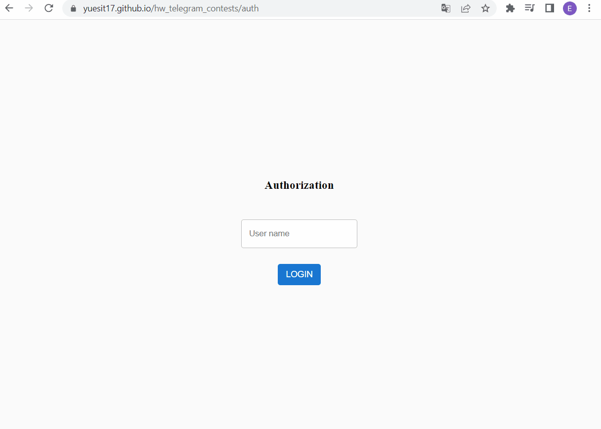

 
  <h1>Project telegram contest chart 📈</h1>
  <h3>Auto formatted with Prettier, tested with Jest + Testing-library + Redux-saga-test-plan</h3>

## What is this and why is it 🤔

- The topic was taken from telegram contest https://t.me/contest/7 
- And it is needed for studying new technologies and structuring knowledge

## Features 💻

- Proven, scalable and easy-to-understand project with Redux Ducks architecture
- Client written in modern React with using NextJS and Next/router, only functional components with React hooks and custom hooks
- A variety of custom light-weight UI components (with using [emotion](https://emotion.sh/docs/styled)) such as input, page, layout etc
- Redux and Redux-saga are used to manage application state with reduxjs/toolkit
- Server written in node.js with express

## How run app 🚀

- Install packages using command `yarn install`
- Run app with server `yarn local`
- Run app witout server with mock data `yarn dev`
- App should now be running on http://localhost:3000/
- Run srorybook `yarn storybook`

## Running tests and check code ✔️

- Run using command `yarn test`
- Check project with lint using command `yarn lint`
- Run test and lint using command `yarn precommit`
- Check UI components with command `yarn chromatic`

## What's missing?

There are features missing from this showcase product which should exist in a real product:

### Proper authentication system 🔐

We currently store the username in local storage and run the project without valid credentials. In a real product, we would like to implement a proper email and password authentication system.

### Chart map modification🗺️

Need to add a slider on the chart map to view the details

### Tooltip for chart📋

Need to add tooltip for coordinate points

### Cypress tests 🧪

Need to implement UI testing in a project using Cypress.

## License

[MIT](https://opensource.org/licenses/MIT)
